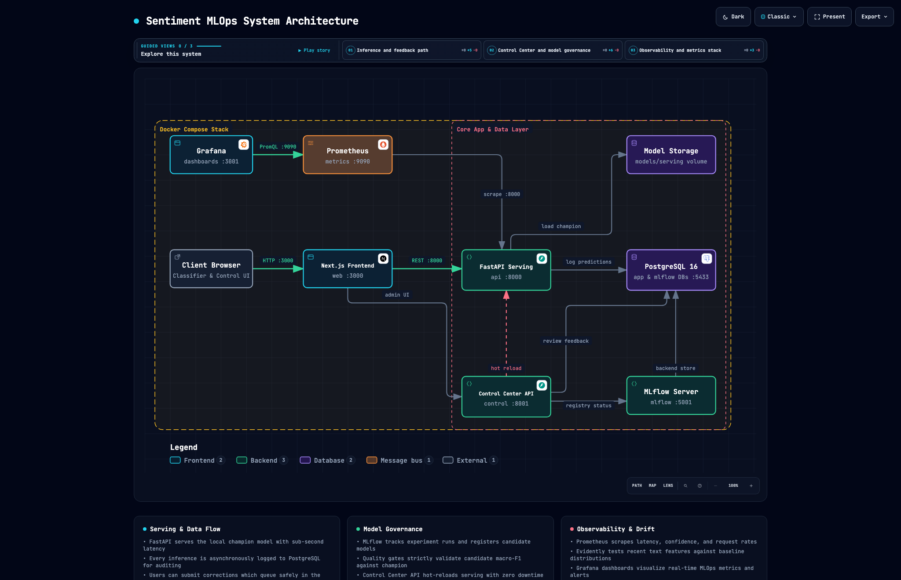
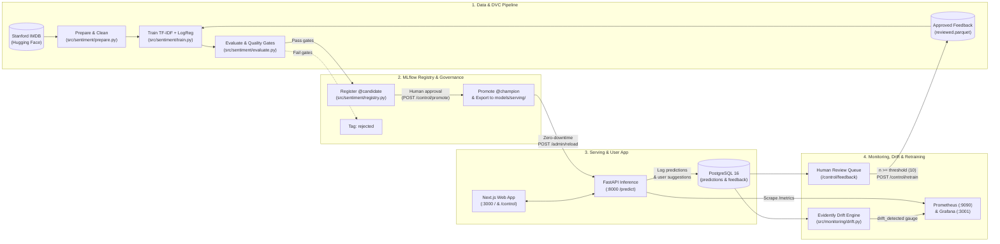

# Sentiment MLOps — End-to-End Machine Learning Lifecycle Platform

[](https://www.python.org/)
[](https://fastapi.tiangolo.com/)
[](https://nextjs.org/)
[](https://scikit-learn.org/)
[](https://mlflow.org/)
[](https://dvc.org/)
[](https://www.postgresql.org/)
[](https://prometheus.io/)
[](https://grafana.com/)
[](https://www.evidentlyai.com/)
[](https://docs.docker.com/compose/)
[](./LICENSE)

An end-to-end, production-style **MLOps reference platform** built around a movie review sentiment classifier ([Stanford IMDB dataset](https://huggingface.co/datasets/stanfordnlp/imdb)).

Rather than stopping at a trained notebook or a single inference endpoint, this project connects **two complementary experiences** inside one self-contained Docker Compose stack:

1. **The User-Facing Application (`/`)**: Users paste a movie review, click **Classify**, receive a sentiment prediction (`positive` / `negative`) with confidence and model version metadata, and submit instant label feedback (`👍 Correct` / `👎 Incorrect`).
2. **The MLOps Control Center (`/control`)**: Operators inspect dataset and DVC pipeline lineage, compare MLflow experiments, verify automated quality gates, promote `@candidate` models to `@champion` with zero-downtime hot reload, monitor live latency/confidence via Prometheus & Grafana, inspect Evidently AI data drift reports, moderate user feedback in a human-in-the-loop review queue, and trigger continuous retraining.

<p align="center">
  <picture>
    <source media="(prefers-color-scheme: dark)" srcset="./diagrams/system-architecture-dark.png">
    <source media="(prefers-color-scheme: light)" srcset="./diagrams/system-architecture-light.png">
    
  </picture>
</p>

> **Interactive Architecture & Workflow Diagrams**: Explore the standalone interactive HTML diagram suite in [`diagrams/`](./diagrams/README.md) (`open diagrams/index.html`) covering System Architecture, Continuous Retraining Workflow, Data Flow & Lineage, Model Governance State Machine, and the 12-Tool MLOps Lifecycle Map.

---

## Table of Contents

- [Architecture & Closed-Loop Lifecycle](#architecture--closed-loop-lifecycle)
- [Technology Stack](#technology-stack)
- [Service & Port Map](#service--port-map)
- [Quick Start — Run Locally from Scratch](#quick-start--run-locally-from-scratch)
- [Interactive Walkthrough — Try the Full MLOps Loop](#interactive-walkthrough--try-the-full-mlops-loop)
- [Quality Gates & Model Governance](#quality-gates--model-governance)
- [Project Structure](#project-structure)
- [Configuration & Environment Variables](#configuration--environment-variables)
- [Development, Testing & CI/CD](#development-testing--cicd)
- [License](#license)

---

## Architecture & Closed-Loop Lifecycle



### Key Engineering Highlights

- **Reproducible Data & Pipeline Lineage (`DVC`)**: Every stage (`download` $\rightarrow$ `prepare` $\rightarrow$ `export_feedback` $\rightarrow$ `train` $\rightarrow$ `evaluate` $\rightarrow$ `register`) is defined in [`dvc.yaml`](./dvc.yaml) and locked by content MD5 hashes in [`dvc.lock`](./dvc.lock).
- **Alias-Driven Model Registry (`MLflow`)**: Models are governed via modern MLflow Registry aliases (`@candidate` and `@champion`) rather than deprecated stage names. Superseded champions are automatically tagged `retired`.
- **Automated Quality Gates**: No model can become a `@candidate` or `@champion` unless it passes four strict checks in [`src/sentiment/gates.py`](./src/sentiment/gates.py): minimum accuracy, minimum macro-F1, minimum per-class recall, and zero regression beyond tolerance against the active `@champion`.
- **Zero-Downtime Hot Reload**: Promoting a candidate exports the model artifact and triggers `POST /admin/reload` on the inference service, swapping the in-memory pipeline atomically without dropping in-flight HTTP requests.
- **Anti-Poisoning Human Review Queue**: User-submitted label corrections (`POST /feedback`) never enter training data directly. They land in PostgreSQL with `review_status = 'pending'` until a human reviewer approves, relabels, or rejects them in the Control Center (`/control/feedback`).
- **Statistical Data & Prediction Drift (`Evidently AI`)**: Compares a sliding window of recent production predictions against a 2,000-row held-out reference baseline across 7 features (text length, word count, average word length, exclamation count, uppercase ratio, prediction confidence, and label distribution) and exports `drift_share` and `drift_detected` gauges to Prometheus.

---

## Technology Stack

| Layer | Technology | Role in This Project |
|---|---|---|
| **ML & Data Processing** | Python 3.12, `scikit-learn`, `pandas` | Text cleaning, deduplication, sublinear TF-IDF (1–2 n-grams) + Logistic Regression pipeline |
| **Data & Pipeline Versioning** | `DVC` | Deterministic 6-stage DAG (`dvc.yaml`), parameter tracking (`params.yaml`), artifact hashing (`dvc.lock`) |
| **Experiment & Model Registry** | `MLflow` (PostgreSQL backend) | Logs hyperparameters, metrics, evaluation artifacts, and manages `@candidate` / `@champion` aliases |
| **Inference API** | `FastAPI`, `Uvicorn`, `Pydantic` | Serves `@champion` predictions (`/predict`), collects feedback (`/feedback`), exposes `/metrics`, hot-reloads (`/admin/reload`) |
| **Control Center API** | `FastAPI` | Aggregates MLflow registry, DVC lineage, gate verdicts, Evidently drift reports, feedback review queue, and retraining triggers |
| **Web Frontend** | `Next.js 16` (App Router), `React 19`, `TypeScript`, `Tailwind CSS` | User classifier UI (`/`) and 6-tab MLOps Control Center (`/control/*`) |
| **Database & Migrations** | `PostgreSQL 16`, `SQLAlchemy 2.0`, `Alembic` | Dual-database setup: `app` DB (`predictions` + `feedback` tables) and `mlflow` DB (registry store) |
| **Metrics & Alerting** | `Prometheus` | Scrapes `/metrics` every 15s; evaluates alert rules (`ApiDown`, `HighErrorRate`, `HighPredictLatencyP95`, `LowMeanConfidence`, `DataDriftDetected`) |
| **Operational Dashboards** | `Grafana` | Pre-provisioned dashboard tracking RPS, p95 latency, label split, mean confidence, active model version, and drift status |
| **Data Drift Analysis** | `Evidently AI` | Runs Wasserstein and Jensen-Shannon distribution checks on text features and model outputs; generates JSON + interactive HTML reports |
| **Container Orchestration** | `Docker`, `Docker Compose` | Packages and networks all 7 services with healthchecks and persistent volumes |
| **CI & Package Management** | `GitHub Actions`, `uv`, `Ruff`, `pytest` | Automated linting, 34 unit/integration tests, DVC DAG validation, Next.js build, and multi-image Docker builds |

---

## Service & Port Map

When the stack is running via Docker Compose, the following services are available on `localhost`:

| Service | Local URL | Purpose | Default Dev Credentials |
|---|---|---|---|
| **Web App (Classifier)** | [http://localhost:3000](http://localhost:3000) | User-facing sentiment classifier + feedback widget | — |
| **MLOps Control Center** | [http://localhost:3000/control](http://localhost:3000/control) | Overview, Lineage, Experiments, Registry, Drift, Feedback & Retraining | Admin token: `dev-admin-token` |
| **Inference API** | [http://localhost:8000/docs](http://localhost:8000/docs) | `/predict`, `/feedback`, `/health`, `/model-info`, `/metrics`, `/admin/reload` | Header `X-Admin-Token: dev-admin-token` |
| **Control Center API** | [http://localhost:8001/docs](http://localhost:8001/docs) | `/control/overview`, `/control/registry`, `/control/lineage`, `/control/drift`, `/control/feedback`, `/control/retrain` | Header `X-Admin-Token: dev-admin-token` |
| **MLflow UI** | [http://localhost:5001](http://localhost:5001) | Experiment runs, logged artifacts, and `sentiment-classifier` Model Registry | — |
| **Grafana** | [http://localhost:3001](http://localhost:3001) | Provisioned *Sentiment MLOps* real-time operational dashboard | `admin` / `admin` |
| **Prometheus** | [http://localhost:9090](http://localhost:9090) | PromQL query explorer, target health (`/targets`), and alert states (`/alerts`) | — |
| **PostgreSQL 16** | `localhost:5433` (internal `5432`) | Hosts `app` database (`predictions`, `feedback`) and `mlflow` database | `mlops` / `mlops-dev-password` |

> **Port Notes for macOS / Local Dev**:
> - **MLflow** maps to host port **`5001`** (`5001:5000`) because macOS AirPlay Receiver occupies port `5000`.
> - **PostgreSQL** maps to host port **`5433`** (`5433:5432`) so it never collides with a local PostgreSQL instance on port `5432`.

---

## Quick Start — Run Locally from Scratch

### Prerequisites

1. **[Docker Desktop](https://www.docker.com/products/docker-desktop/)** (running with Docker Compose v2).
2. **[uv](https://docs.astral.sh/uv/)** (fast Python package & environment manager):
   ```bash
   # macOS / Linux:
   curl -LsSf https://astral.sh/uv/install.sh | sh
   ```
3. **Git** (and an internet connection for the initial Hugging Face dataset download).

### 4-Step Cold Start

Run the following commands from the repository root:

```bash
# 1. Create the Python 3.12 virtual environment and install all dependencies
uv sync

# 2. Start PostgreSQL and the MLflow tracking server first
docker compose up -d --build --wait postgres mlflow

# 3. Run the DVC pipeline (download IMDB -> clean -> train -> evaluate gates -> register @candidate)
uv run dvc repro

# 4. Promote the candidate model to @champion (exports to models/serving/) and start all 7 services
uv run python -m sentiment.registry promote
docker compose up -d --build --wait
```

Once step 4 completes, open:
- **Classifier UI**: [http://localhost:3000](http://localhost:3000)
- **MLOps Control Center**: [http://localhost:3000/control](http://localhost:3000/control)

> **Tip — Resetting or Re-running from Scratch**:
> If you ever wipe your Docker volumes (`docker compose down -v`) while keeping local files, force DVC to re-log and re-register the model into the fresh MLflow database with:
> ```bash
> docker compose up -d --build --wait postgres mlflow
> uv run dvc repro -f train
> uv run python -m sentiment.registry promote
> docker compose up -d --build --wait
> ```

---

## Interactive Walkthrough — Try the Full MLOps Loop

Once the stack is up, you can walk through every stage of the machine learning lifecycle in minutes:

### 1. Classify a Review & Submit User Feedback
1. Open [http://localhost:3000](http://localhost:3000), enter a movie review, and click **Classify**.
2. Observe the predicted sentiment, confidence score, and active model version (`v1`).
3. Click **`👍 Correct`** or **`👎 Incorrect`** underneath the result to submit user feedback.
4. Visit [http://localhost:3000/control/feedback](http://localhost:3000/control/feedback) to see your submission waiting in the **Human Review Queue** (`Pending` tab).

### 2. Simulate Production Traffic & Trigger Data Drift
Generate normal traffic first, then send shifted traffic (short, all-caps, exclamation-heavy reviews) to see Evidently and Prometheus detect data drift:

```bash
# Send 150 normal IMDB-like reviews
uv run python scripts/simulate_traffic.py --n 150

# Run a drift check (status should be "ok")
curl -s -X POST http://localhost:8001/control/drift/run -H "X-Admin-Token: dev-admin-token" | python3 -m json.tool

# Now send 300 drifted reviews (short, shouted, "!!!")
uv run python scripts/simulate_traffic.py --n 300 --shift

# Re-run drift detection (status flips to "drift" across text features & confidence)
curl -s -X POST http://localhost:8001/control/drift/run -H "X-Admin-Token: dev-admin-token" | python3 -m json.tool
```

Now open:
- **Control Center Drift Tab**: [http://localhost:3000/control/drift](http://localhost:3000/control/drift) (includes the embedded Evidently HTML distribution report).
- **Prometheus Alerts**: [http://localhost:9090/alerts](http://localhost:9090/alerts) (watch `DataDriftDetected` fire).
- **Grafana Dashboard**: [http://localhost:3001](http://localhost:3001) (login `admin` / `admin` $\rightarrow$ *Dashboards* $\rightarrow$ *Sentiment MLOps*).

### 3. Human-in-the-Loop Review & Continuous Retraining
Simulate 12 user feedback items and approve them into the verified dataset:

```bash
uv run python scripts/simulate_feedback.py --n 12
```

Now trigger retraining either from the **Feedback & Retraining** UI ([http://localhost:3000/control/feedback](http://localhost:3000/control/feedback)) by clicking **Trigger Model Retraining**, or via CLI:

```bash
uv run python -m sentiment.retrain run
```

What happens automatically:
1. Approved reviews are exported from PostgreSQL to `data/feedback/reviewed.parquet`.
2. `train.py` merges the approved feedback with the base IMDB training split (deduplicating in favor of the latest human-verified label).
3. `evaluate.py` scores the new model against the held-out test set and checks all quality gates against the current `@champion`.
4. `registry.py` registers the new version (`v2`) in MLflow with alias `@candidate`.

### 4. Promote `@candidate` to `@champion` with Zero-Downtime Reload
1. Open [http://localhost:3000/control/registry](http://localhost:3000/control/registry).
2. Click **Approve** next to the `@candidate` version (or run `uv run python -m sentiment.registry promote`).
3. Verify that the inference API is now serving `v2` without restarting the container:
   ```bash
   curl -s http://localhost:8000/model-info | python3 -m json.tool
   ```

---

## Quality Gates & Model Governance

Defined in [`params.yaml`](./params.yaml) and enforced by [`src/sentiment/gates.py`](./src/sentiment/gates.py) both at registration time and at promotion time:

| Gate Check | Parameter (`params.yaml`) | Default Threshold | Purpose |
|---|---|---|---|
| **Minimum Accuracy** | `gates.min_accuracy` | `>= 0.88` | Ensures overall classification accuracy on the held-out test split |
| **Minimum Macro-F1** | `gates.min_macro_f1` | `>= 0.88` | Ensures balanced precision and recall across both sentiment classes |
| **Minimum Per-Class Recall** | `gates.min_class_recall` | `>= 0.85` | Prevents models that achieve high accuracy by sacrificing one class |
| **No Champion Regression** | `gates.max_regression` | `<= 0.01` drop | Blocks candidates whose macro-F1 drops by more than `0.01` vs. the current `@champion` |

If any gate fails:
- The model version is tagged `status = rejected` and `rejection_reason = <failed_checks>` in MLflow.
- The `@candidate` alias is **not** assigned, and `promote` refuses to export the model.

---

## Project Structure

```text
.
├── .github/workflows/ci.yml        # GitHub Actions CI (ruff, pytest, dvc dag, next build, docker build)
├── diagrams/                       # Interactive HTML architecture, workflow, lineage & lifecycle diagrams
├── docker/postgres/init.sql        # Initializes `app` and `mlflow` databases in PostgreSQL
├── migrations/                     # Alembic migrations (0001_create_predictions, 0002_create_feedback)
├── monitoring/
│   ├── prometheus.yml              # Scrape configs for api (:8000) and control (:8000)
│   ├── alerts.yml                  # Alert rules (ApiDown, HighErrorRate, Latency, Confidence, Drift)
│   └── grafana/                    # Auto-provisioned Prometheus datasource & Sentiment MLOps dashboard
├── scripts/
│   ├── simulate_traffic.py         # Generates normal or drifted (--shift) production traffic
│   └── simulate_feedback.py        # Simulates user feedback submissions and human approvals
├── src/
│   ├── sentiment/                  # Core ML package
│   │   ├── config.py               # Shared paths, params loader, MLflow URI setup
│   │   ├── data.py                 # Hugging Face IMDB loader & schema validation
│   │   ├── prepare.py              # HTML cleaning, deduplication, split profiling (stats.json)
│   │   ├── train.py                # TF-IDF + LogisticRegression training + feedback merge + MLflow logging
│   │   ├── evaluate.py             # Hold-out test evaluation & quality gate execution
│   │   ├── gates.py                # Pure quality gate evaluation logic
│   │   ├── registry.py             # MLflow registration, @candidate/@champion promotion & model export
│   │   └── retrain.py              # Feedback export & end-to-end retraining orchestrator
│   ├── api/                        # Inference Service (FastAPI)
│   │   ├── main.py                 # /predict, /feedback, /health, /model-info, /metrics, /admin/reload
│   │   └── db.py                   # SQLAlchemy models (Prediction, Feedback) & review queue queries
│   ├── control/
│   │   └── main.py                 # MLOps Control Center API + scheduled drift background loop
│   └── monitoring/
│       ├── features.py             # Text feature extractor for drift analysis
│       └── drift.py                # Evidently AI DataDriftPreset runner (JSON + HTML output)
├── tests/                          # 34 unit & integration tests (API, gates, drift, feedback, retrain)
├── web/                            # Next.js 16 (TypeScript) frontend (/ and /control/*)
├── Dockerfile.api                  # Inference service image (runs `alembic upgrade head` on start)
├── Dockerfile.control              # Control Center API image
├── Dockerfile.mlflow               # MLflow server image with psycopg2
├── docker-compose.yml              # 7-service orchestration with healthchecks
├── dvc.yaml                        # 6-stage DVC pipeline definition
├── dvc.lock                        # Locked stage hashes for data & pipeline lineage
├── params.yaml                     # Hyperparameters, gate thresholds, drift & retraining settings
└── pyproject.toml                  # Python project metadata, dependencies & Ruff/pytest config
```

---

## Configuration & Environment Variables

Default settings work out of the box for local development. To customize credentials or intervals, copy [`.env.example`](./.env.example) to `.env`:

```bash
cp .env.example .env
```

| Variable | Default | Description |
|---|---|---|
| `ADMIN_TOKEN` | `dev-admin-token` | Token required in `X-Admin-Token` header for model promotion, feedback review, drift runs, and retraining |
| `POSTGRES_PASSWORD` | `mlops-dev-password` | Password for the `mlops` PostgreSQL user |
| `GRAFANA_PASSWORD` | `admin` | Admin password for Grafana (`http://localhost:3001`) |
| `DRIFT_INTERVAL_MIN` | `15` | Background Evidently drift check interval in minutes (`0` disables scheduled loop) |

---

## Development, Testing & CI/CD

Run the full verification suite locally before pushing changes:

```bash
# Run Python linter (Ruff)
uv run ruff check src tests scripts migrations

# Run the 34-test pytest suite (API, quality gates, drift, feedback DB, retraining)
uv run pytest -v

# Validate the DVC pipeline DAG
uv run dvc dag

# Lint and build the Next.js frontend
npm --prefix web run lint && npm --prefix web run build

# Validate Docker Compose configuration
docker compose config --quiet
```

All five checks above are automatically executed on every push and pull request by the GitHub Actions workflow in [`.github/workflows/ci.yml`](./.github/workflows/ci.yml).

---

## License

This project is released under the [MIT License](./LICENSE).
